# Отчёт по практической работе №9

## Практическая работа №9 — SOLID

Выполнил: Малинин Константин Николаевич, М-25 ИО
Дата: 19.11.2026. Вариант №5 — «Управление документами».
https://github.com/konstmalinin-maker/solid-refactoring-variant-5
Объединённый PR: https://github.com/konstmalinin-maker/solid-refactoring-variant-5/pull/6

Цель — сохранить поведение документного API при рефакторинге по SOLID. Выполнены основная часть и A–G. Основной отчёт занимает 8 страниц; отдельное приложение содержит подробный разбор, ответы и 23 оригинальных скриншота, включая каждое допзадание.

PDF содержит описание варианта без готового исходника. Учебный legacy/bad_code.py подготовлен по описанию с намеренными нарушениями, а не получен от преподавателя. Работа индивидуальная: независимого ревью одногруппника не было; проведена самопроверка.

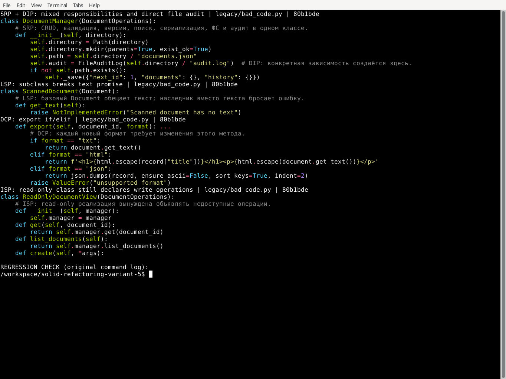

Скриншот 1 — действительный исходный код и аннотации SRP/OCP/LSP/ISP/DIP.

DocumentManager смешивал валидацию, версии, экспорт, JSON и аудит (SRP/DIP). Для форматов использовалось if/elif (OCP). Скан наследовал текстовый контракт, который отвергал (LSP). Клиенту чтения навязывались операции записи (ISP).

## 1. Контракт и метрики до рефакторинга

До изменений зафиксированы 23 характеризующих теста: 21 проверка публичного API и две исторические проверки антипримеров LSP/ISP. Последние всегда проверяют сохранённый legacy; новый дизайн отдельно проверяется tests_after. Коммит тестов ce98fb0, файлы далее не менялись.

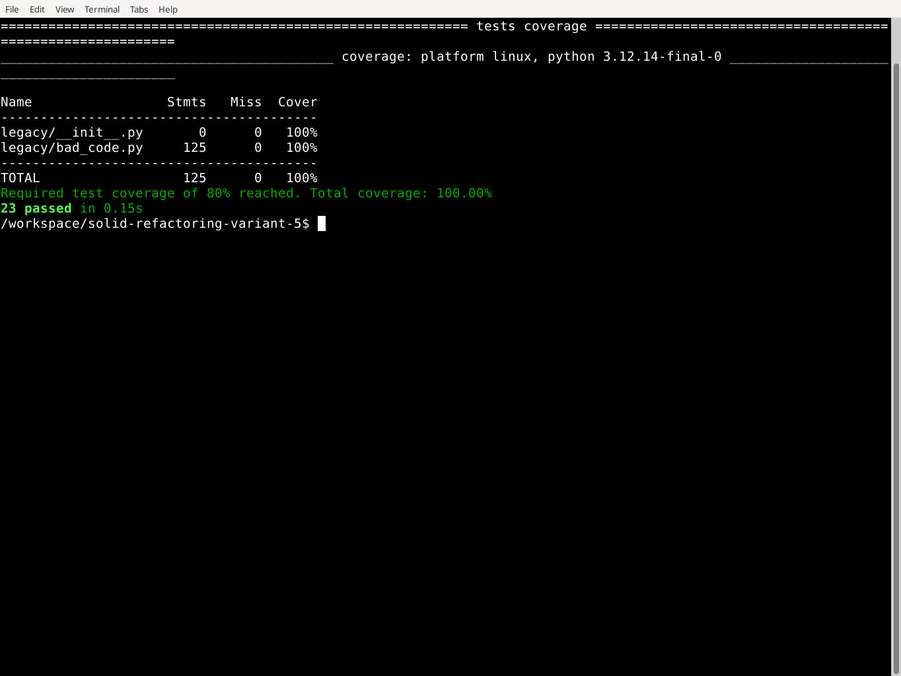

Скриншот 2 — все 23 исходных теста проходят, покрытие legacy 100%.

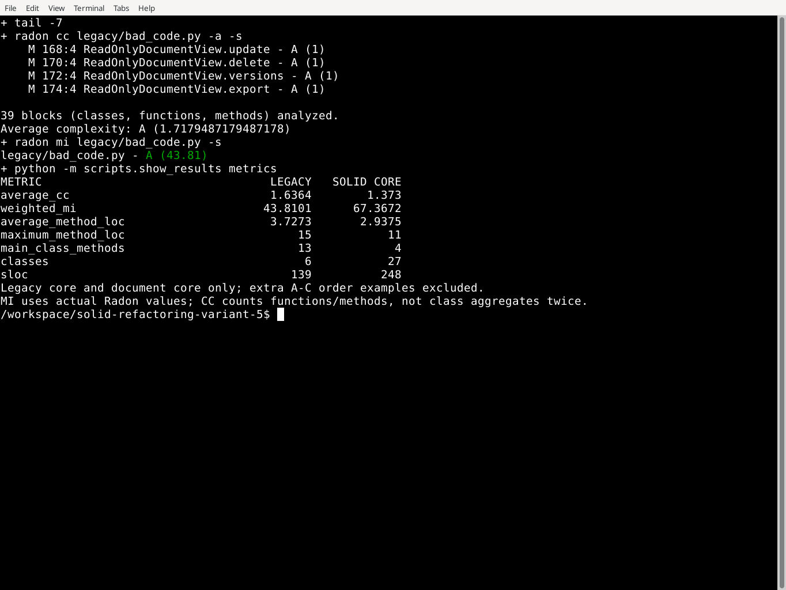

Скриншот 3 — фактические radon cc, radon mi и измерения.

| Метрика документного ядра | До | После |
| --- | --- | --- |
| Средняя CC / weighted MI | 1,6364 / 43,8101 | 1,3730 / 67,3672 |
| Средняя / макс. длина метода | 3,7273 / 15 | 2,9375 / 11 |
| Методов главного обработчика | 13 | 4 |
| Классы / SLOC / покрытие | 6 / 139 / 100% | 27 / 248 / 100% |

CC: функции и методы без повторного учёта агрегатов классов; MI взвешен по SLOC. Заказные примеры A–C исключены из обеих сторон сравнения. У фасада DocumentManager сохраняются делегирующие методы: 13→4 относится к основному обработчику DocumentService.

## 2. SRP и OCP: отдельные шаги

SRP, b21fa1c: выделены команды, запросы, версии, экспорт, репозиторий и аудит. OCP, 7cc463d: стратегии экспорта и реестр заменяют ветвление; новый Markdown-экспорт регистрируется без изменения сервиса.

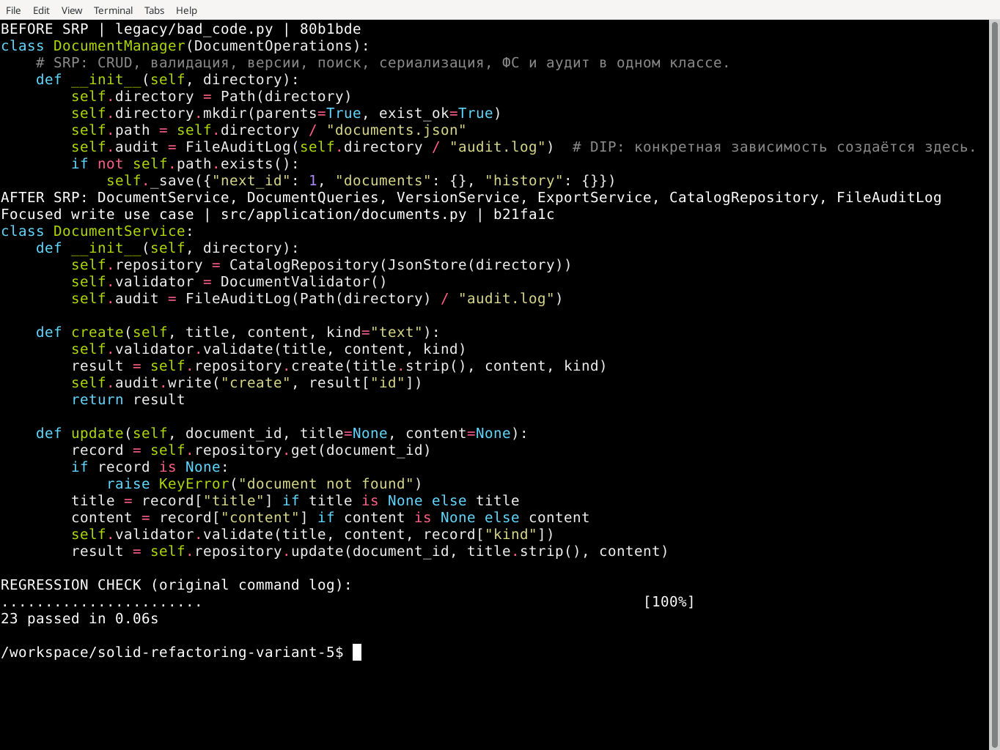

Скриншот 4 — SRP до/после, журнал тех же 23 успешных тестов.

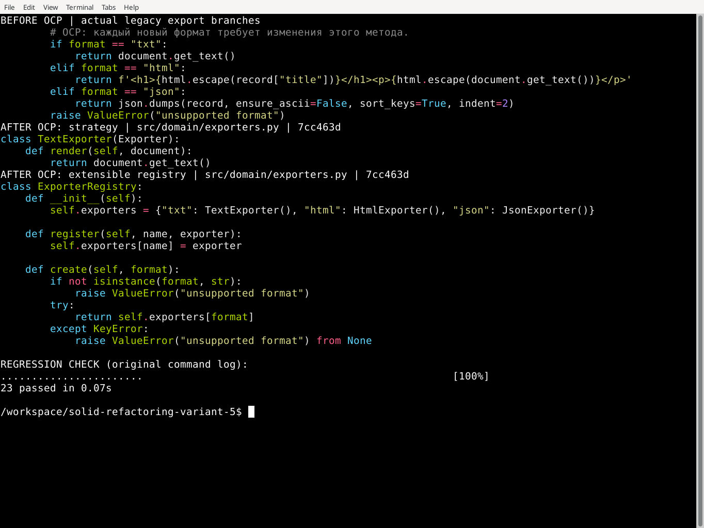

Скриншот 5 — OCP до/после, регрессионные тесты проходят.

## 3. LSP и ISP: корректные контракты

LSP, 91f6139: общий Document обещает snapshot, TextContent описывает отдельную возможность. Скан больше не наследует неподдержанный get_text; старая ошибка TXT/HTML-экспорта сохранена на границе API. ISP, c59bda4: клиент чтения получает только DocumentReader, без фиктивных методов записи.

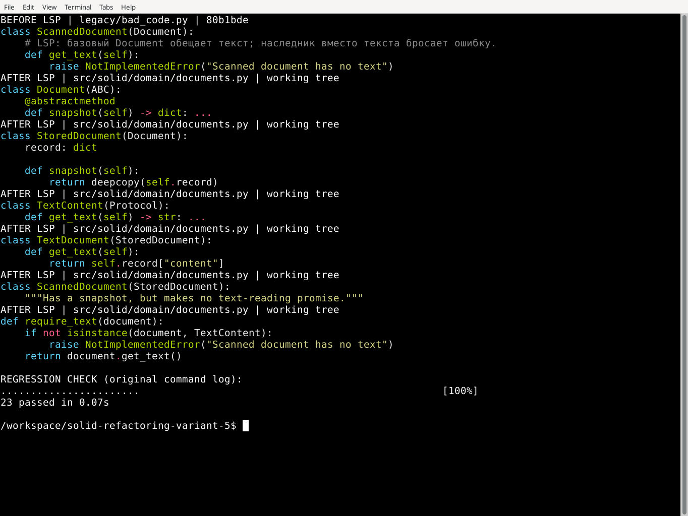

Скриншот 6 — LSP до/после; два вида поддерживают общий контракт.

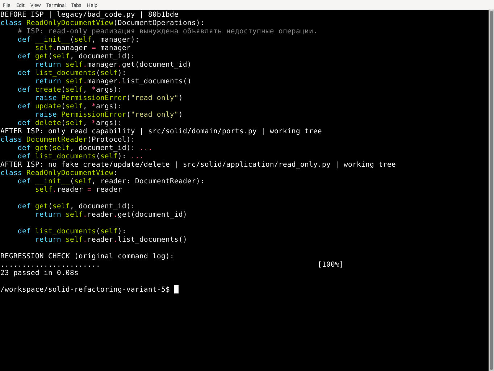

Скриншот 7 — ISP до/после; у read-only клиента нет create/update/delete.

## 4. DIP и структура проекта

DIP, 4100c13: сервис получает порты репозитория и аудита. Конкретные JSON-адаптеры собираются снаружи; тесты подставляют память. Каждый из пяти шагов завершился 23 passed. SHA-проверка подтверждает неизменность legacy, conftest и tests_before.

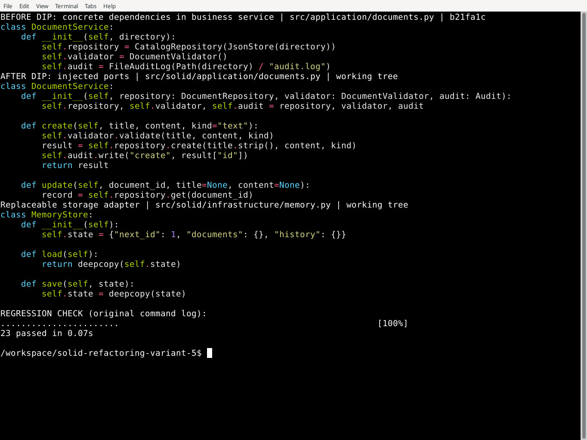

Скриншот 8 — DIP: конкретные зависимости заменены внедрёнными портами.

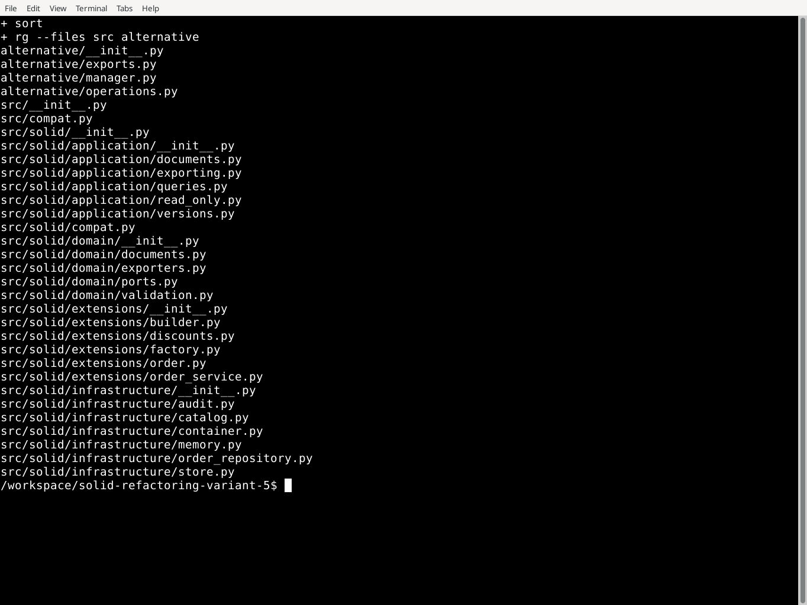

Скриншот 9 — фактическая структура domain/application/infrastructure.

src/solid — стандартная упаковка для mutmut; src.compat сохранён как импортный адаптер. alternative содержит самостоятельный функциональный вариант.

## 5. Итоговая проверка и метрики

Итог: 75 passed = 23 исходных + 52 новых. Покрытие src/solid, включая A–C: 357/357, 100%. Ruff проходит. Покрытие строк само по себе не доказывает качество утверждений — дополнительно выполнен mutmut.

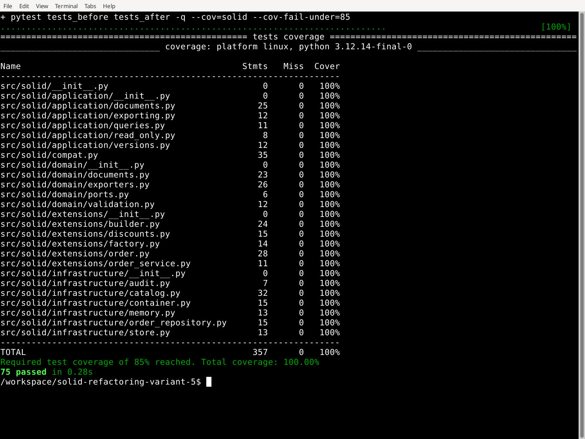

Скриншот 10 — все финальные тесты и покрытие реализации.

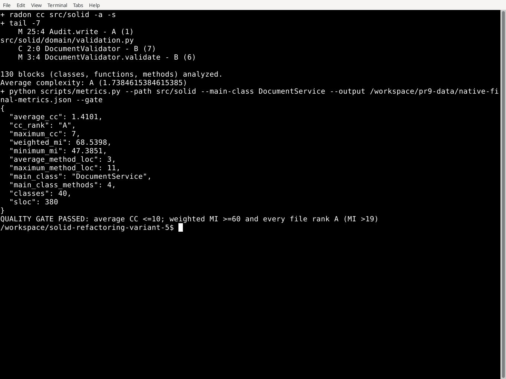

Скриншот 11 — фактические Radon и численные пороги для всей реализации.

Вся реализация: средняя CC 1,4101, weighted MI 68,5398, min MI 47,3851. Радon относит MI>19 к A, поэтому исходные 43,81 уже A; неточная буква из примера PDF не воспроизводится. У ядра MI вырос до 67,3672, но классов и SLOC стало больше — это стоимость разделения.

## 6. Дополнительные задания A–G и PR

A. Factory Method скидок: regular 5%, vip 10%, premium 15%, student 20%; Decimal. Новый provider регистрируется декоратором без правки фабрики/сервиса. B. OrderBuilder валидирует обязательные поля и строит неизменяемый Order; отделяет построение от обработки (SRP). C. Контейнер register/resolve/override собирает OrderService в main.py, тесты подменяют репозиторий (DIP).

D. GitHub Actions: CC≤10, weighted MI≥60, MI каждого файла A, покрытие≥85%, бейдж. Успешный main run 44517856719; контрольный run 44514466635 действительно отклонён по legacy MI. E. Mutmut: 496 всего, 469 killed, 27 survived (5,44%); без пропусков. Слабый тест того же discounts.py имеет 100% line coverage, но 2/6 survivors (33,33%).

F. Независимые функции + dispatch проходят те же 23 теста: CC 1,5, MI 63,8347, 12 типов/181 SLOC; основной дизайн 1,373/67,3672, 27/248. Основной выбран для явных контрактов и расширений; простой функциональный вариант короче для текущего объёма. G. Реальный timeit: 1000 документов legacy 6,913064 с, SOLID 6,838196 с (−1,08%, шум I/O); 1000 заказов 0,001886→0,002447 с (+29,72%, около 0,56 мс из-за фабрики/валидации/стратегии).

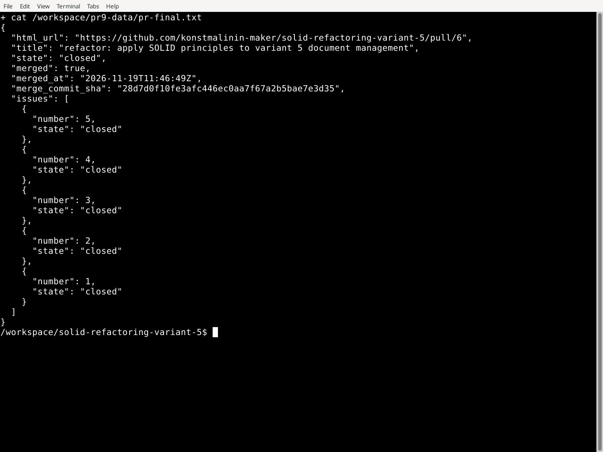

Скриншот 12 — GitHub подтверждает merged=true и закрытие всех пяти Issues.

Самопроверка: docs/self-review.md. Независимое одобрение не имитировалось. Детальные скриншоты A–G, логи и исходные измерения находятся в приложении и docs/evidence.

## 7. Контрольные вопросы. Трудности и решения

1. Характеризующие тесты. Фиксируют фактический контракт старого кода: ответы, ошибки и эффекты. Позволяют менять структуру без непреднамеренного изменения поведения.

2. Зачем покрытие до изменений. Без исходной проверки сложно заметить регрессию. Сначала фиксируются основные сценарии и границы; процент строк не заменяет точных утверждений.

3. Три признака God class. Разные обязанности, много зависимостей, изменения по несвязанным причинам. Пример — валидация, версии и файлы в одном DocumentManager.

4. if/elif и OCP. В ожидаемой точке расширения новый формат требует править работающий диспетчер. Сам по себе условный оператор не запрещён.

5. Strategy и OCP. Клиент вызывает общий контракт. Новый алгоритм добавляется отдельной стратегией и регистрацией без изменения сервиса.

6. Нарушение LSP. Подтип нарушает обещание базового типа. Пример — изменяемый Square вместо Rectangle с независимыми шириной/высотой; здесь — скан, отвергающий get_text.

7. ISP и связанность. Узкий интерфейс убирает ненужные зависимости клиента. Читающему представлению не нужны методы и правила записи.

8. Инверсия зависимостей. Логика зависит от порта, инфраструктура реализует этот порт. Направление идёт к контракту области, а конкретный выбор вынесен в сборку.

9. DIP и тестируемость. Вместо файлового адаптера можно передать memory/fake, контролируя ответы и ошибки без изменения бизнес-кода.

10. Что улучшилось. CC 1,6364→1,3730; MI 43,8101→67,3672; max LOC 15→11; методов основного обработчика 13→4. Покрытие 100%; объём и число типов выросли.

11. Если тест упал. Остановить следующий шаг, найти первое отличие от контракта, исправить рефакторинг. Менять тест — только при отдельном изменении требований.

12. Как избежать усложнения. Выделять контракты под реальные различия и границы, сравнивать с простым решением и измерять стоимость. Dispatch-альтернатива показывает компромисс.

Трудности и решения. Неверное наследование скана устранено разделением возможностей, старая ошибка оставлена на границе API. Конфликт mutmut с именем src решён стандартным пакетом solid и совместимым импортом. Мутации выявили слабые regex-проверки ошибок: добавлены точные exception.args, исходные тесты не менялись. Замеры выполнены после mutmut, замедление заказа объяснено. Внешнее ревью недоступно — выполнена самопроверка.

Воспроизведение: pip install -r requirements.txt; python scripts/check_frozen.py; pytest tests_before tests_after --cov=solid --cov-fail-under=85; python scripts/metrics.py --path src/solid --output metrics.json --gate; mutmut run --max-children 2; python -m scripts.benchmark. Полные команды, исходные JSON и все 23 скриншота — в README, приложении и комплекте.
