# Отчёт по практической работе №9

## Практическая работа №9

Рефакторинг кода по принципам SOLID

Выполнил: Малинин Константин Николаевич
Группа: М-25 ИО
Дата: 19.11.2026
Вариант №5 — «Управление документами»

Цель — сохранить поведение программы при разделении ответственностей и зависимостей, проверить пять принципов SOLID тестами и сравнить качество кода до и после изменений. Выполнены основная часть и дополнительные задания A–G.

Репозиторий:
https://github.com/konstmalinin-maker/solid-refactoring-variant-5
Объединённый Pull Request:
https://github.com/konstmalinin-maker/solid-refactoring-variant-5/pull/6

Программа создаёт, изменяет и удаляет документы, хранит версии, восстанавливает предыдущие состояния и экспортирует TXT, HTML, JSON. Отдельные примеры заказов реализованы для буквальных требований дополнительных заданий A–C и G.

В приложенном PDF описан вариант, но отсутствует готовый файл исходного кода. Поэтому legacy/bad_code.py подготовлен как учебная реализация по описанию, с намеренными нарушениями SOLID. Этот файл не выдаётся за исходник преподавателя.

Работа выполнена индивидуально. Независимое ревью одногруппника не проводилось; вместо него выполнена документированная самопроверка. Чужое одобрение PR не имитировалось.

В расширенный отчёт включены 23 скриншота реального выполнения. Оригиналы PNG и исходные журналы сохранены в комплекте. Большой объём обусловлен подтверждениями основной части и всех допзаданий.

## 1. Анализ исходного кода

DocumentManager одновременно проверял входные данные, управлял версиями, формировал экспорт и работал с JSON и журналом. Для изменения формата требовалось добавлять if/elif. ScannedDocument наследовал текстовый контракт, но get_text выбрасывал NotImplementedError. ReadOnlyDocumentView был вынужден объявлять операции записи.

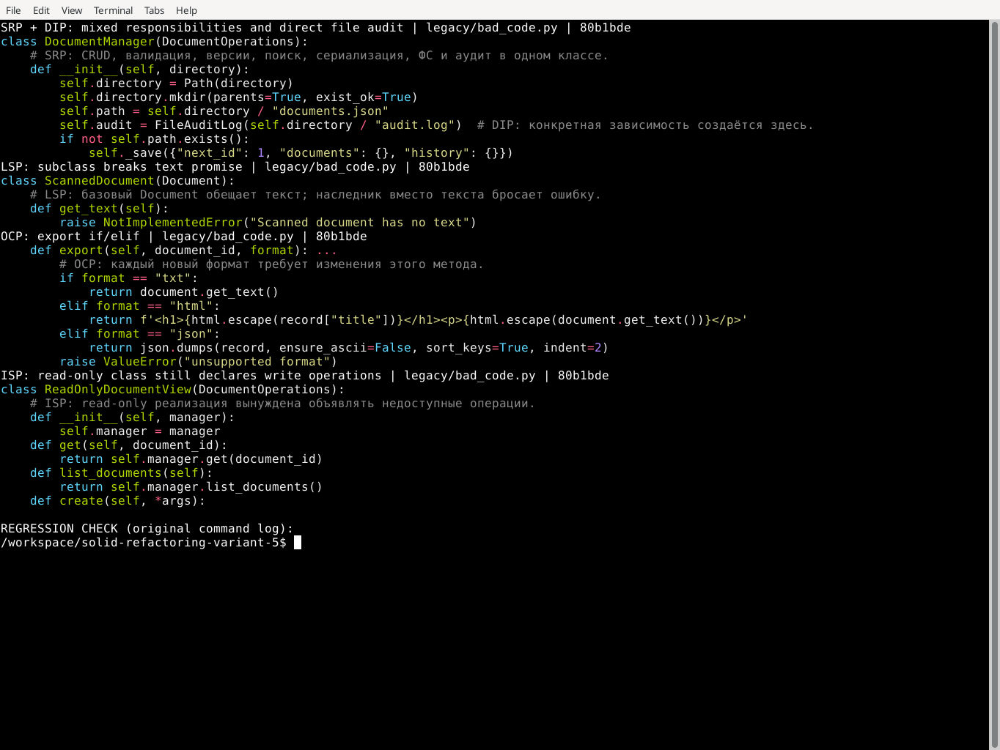

Скриншот 1 — исходный код из первого коммита, подсветка и аннотации нарушений SOLID.

Нарушения: SRP — несколько причин изменения одного класса; OCP — редактирование ветвления экспорта; LSP — неподдержанный метод наследника; ISP — лишние методы клиента чтения; DIP — создание файлового хранилища и аудита в бизнес-коде.

## 2. Характеризующие тесты до изменений

Сначала зафиксированы 23 теста: 21 проверка публичного API менеджера и две проверки исторических антипримеров LSP/ISP. Они описывают наблюдаемое поведение, включая ошибки, версии, копирование возвращаемых данных и точный формат экспорта.

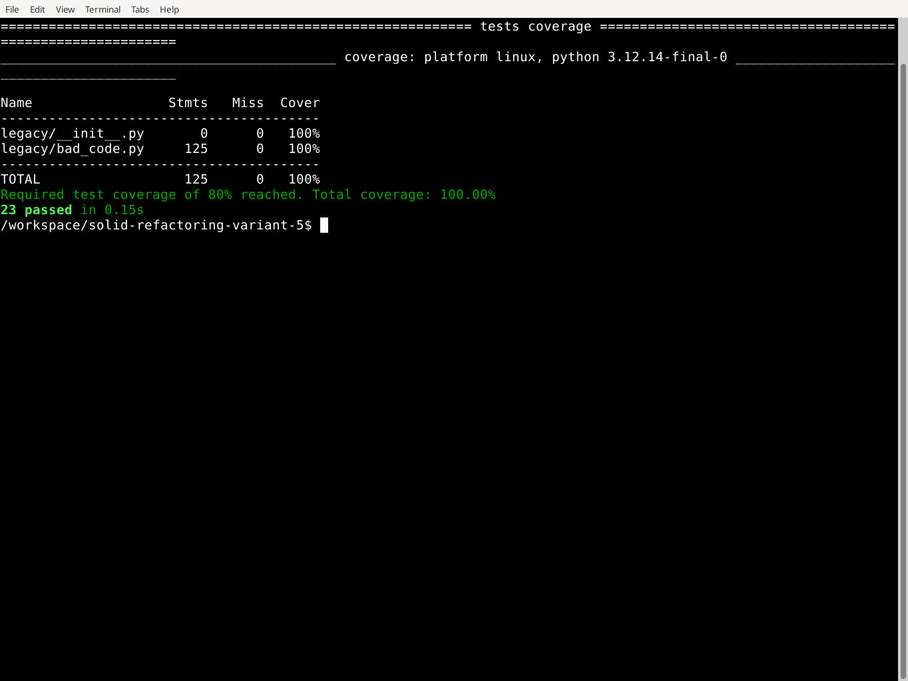

Скриншот 2 — legacy: 23 passed, покрытие строк 100% (125 из 125).

Тесты tests_before и conftest.py зафиксированы коммитом ce98fb0 до рефакторинга и далее не менялись. После каждого шага запускался тот же набор. Две проверки антипримеров продолжают обращаться к сохранённому legacy; корректность нового LSP/ISP отдельно проверяют tests_after.

```text
pytest tests_before --backend=legacy -q --cov=legacy --cov-fail-under=80
python scripts/check_frozen.py
```

## 3. Метрики исходного решения

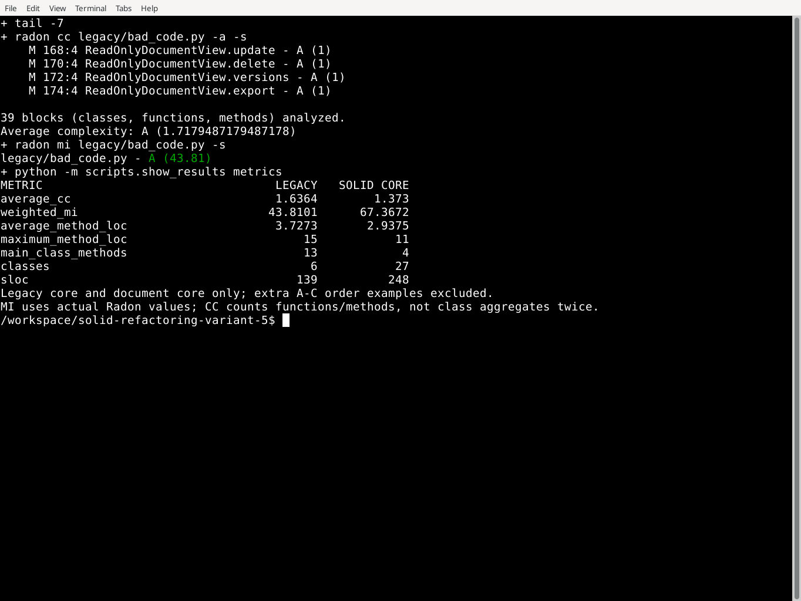

Скриншот 3 — фактический вывод radon cc, radon mi и таблица измерений.

| Метрика основного варианта | До | После |
| --- | --- | --- |
| Средняя CC функций/методов | 1,6364 | 1,3730 |
| Взвешенный MI (вес SLOC) | 43,8101 | 67,3672 |
| Средняя / макс. длина метода | 3,7273 / 15 | 2,9375 / 11 |
| Методов главного обработчика | 13 | 4 |
| Классов / SLOC | 6 / 139 | 27 / 248 |
| Покрытие строк | 100% | 100% |

Сравнение ограничено документным ядром: примеры заказов A–C исключены из обеих сторон. CC учитывает функции и методы без повторного включения агрегатов классов. MI усредняется с весами SLOC. Поэтому средняя CC в таблице отличается от raw radon -a, который включает агрегаты классов.

## 4. SRP — отдельные обязанности

Коммит b21fa1c. Запись выделена в DocumentService, чтение — в DocumentQueries, версии — в VersionService, экспорт — в ExportService, файловый доступ и аудит — в отдельные адаптеры. DocumentManager сохранён как совместимый фасад.

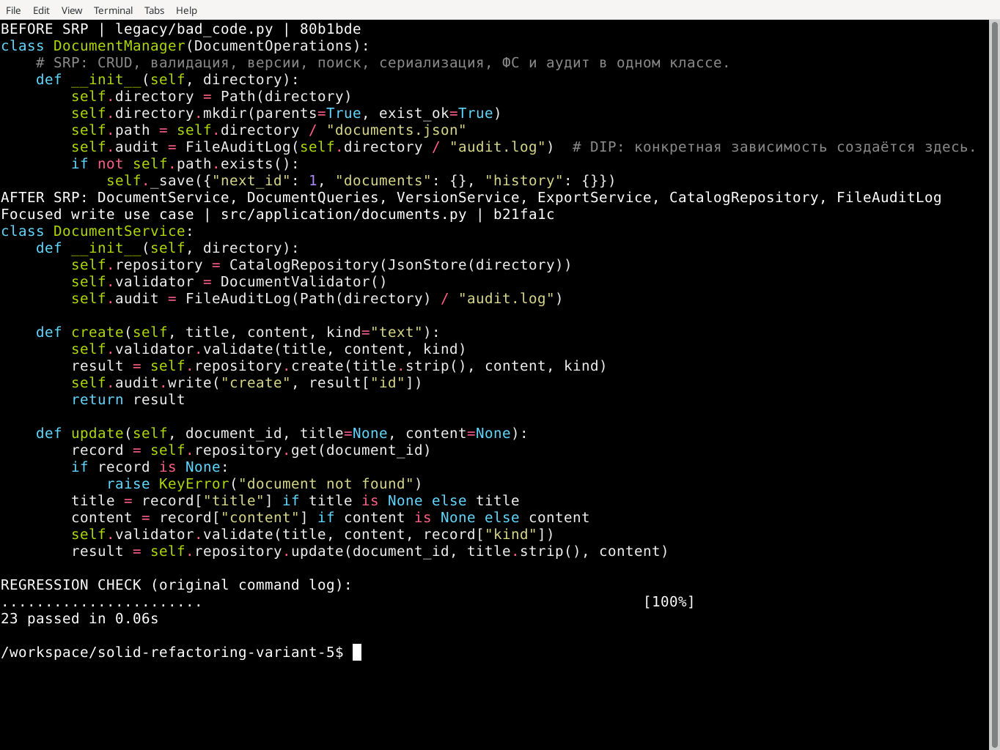

Скриншот 4 — исходный менеджер, выделенный сервис и журнал 23 успешных регрессионных тестов.

Изменение правил версий теперь локализуется в сервисе версий, а изменение JSON-хранилища — в инфраструктуре. Это уменьшает число независимых причин изменения одного класса.

## 5. OCP — расширение экспорта

Коммит 7cc463d. Ветвление по формату заменено стратегиями TextExporter, HtmlExporter, JsonExporter и реестром ExporterRegistry. ExportService выбирает зарегистрированную стратегию через единый контракт.

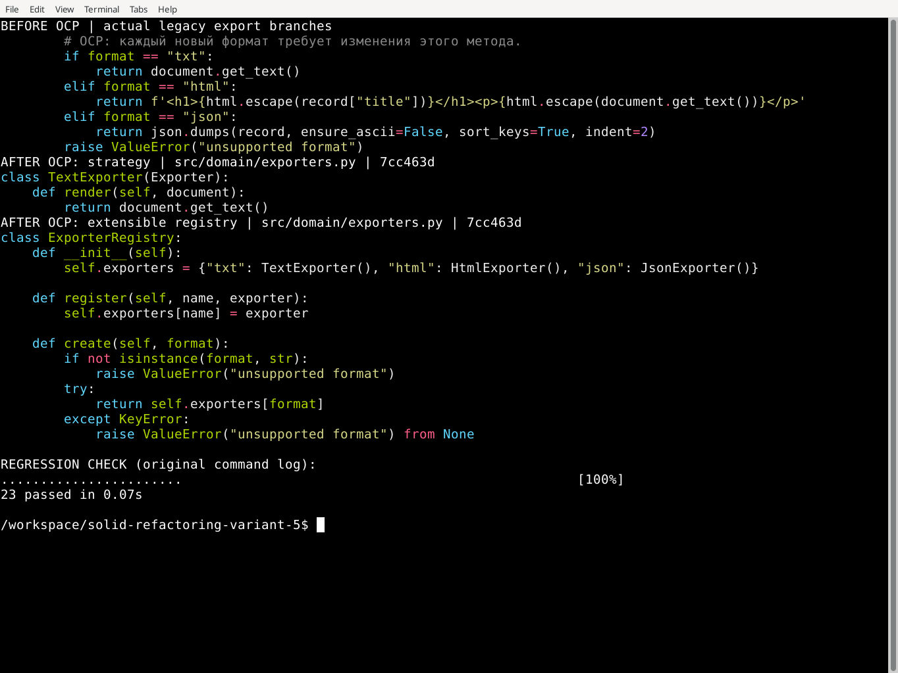

Скриншот 5 — if/elif до изменений и стратегии с реестром после; исходные тесты проходят.

Тест дополнительного Markdown-экспортера регистрирует новую реализацию без правки ExportService. Изменение существующих требований всё ещё может требовать изменения кода; OCP здесь относится к предусмотренной точке расширения форматов.

## 6. LSP — корректный контракт документа

Коммит 91f6139. Общий Document обещает snapshot, который поддерживают оба вида. Получение текста вынесено в отдельный TextContent; ScannedDocument больше не наследует текстовое обещание.

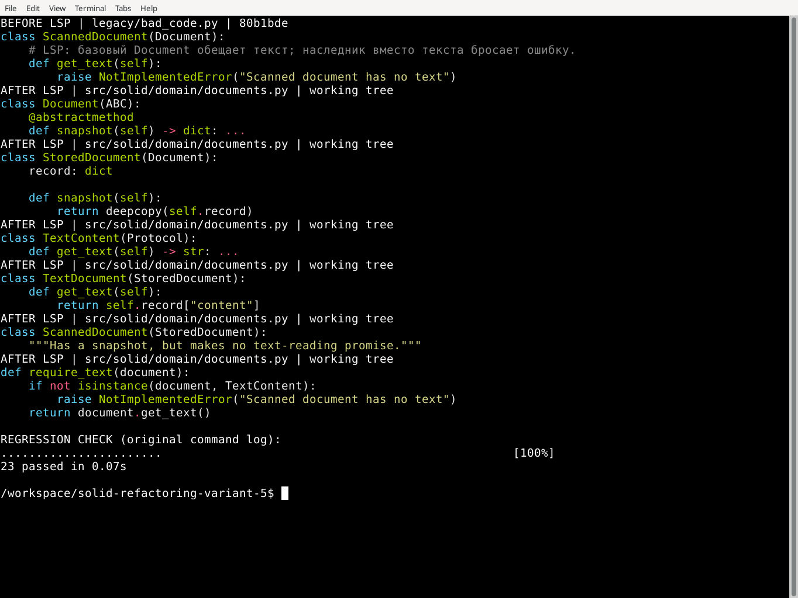

Скриншот 6 — нарушающий контракт наследник и новое разделение возможностей документа.

На границе прежнего API require_text сохраняет старую ошибку при TXT/HTML-экспорте скана. Это совместимость вызывающего кода, а не неподдержанный метод в новом подтипе. JSON-экспорт обоих типов работает; подстановка в общий контракт snapshot проверена отдельно.

## 7. ISP — узкие интерфейсы

Коммит c59bda4. Контракты чтения, записи, истории и аудита разделены на DocumentReader, DocumentWriter, VersionReader и Audit. Клиент чтения получает только DocumentReader.

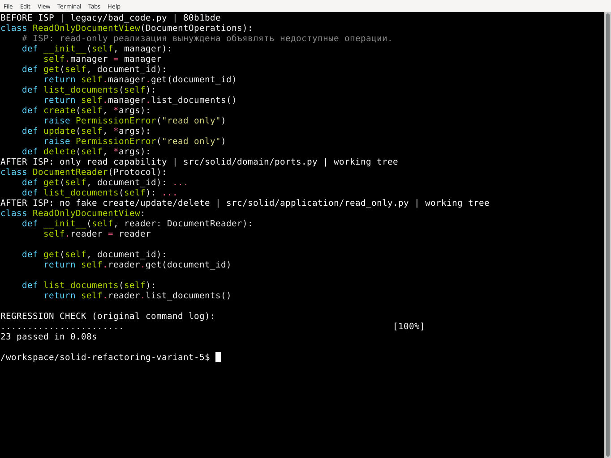

Скриншот 7 — старый клиент с неподдержанными операциями и новый ReadOnlyDocumentView.

Новый клиент не объявляет create, update и delete. Тесты проверяют чтение и отсутствие этих методов. Изменение способа записи не требует менять контракт клиента, который только читает документы.

## 8. DIP — внедрение зависимостей

Коммит 4100c13. DocumentService зависит от контрактов репозитория и аудита. Конкретные CatalogRepository, JsonStore и FileAuditLog собираются на внешней границе, а не создаются внутри операций бизнес-логики.

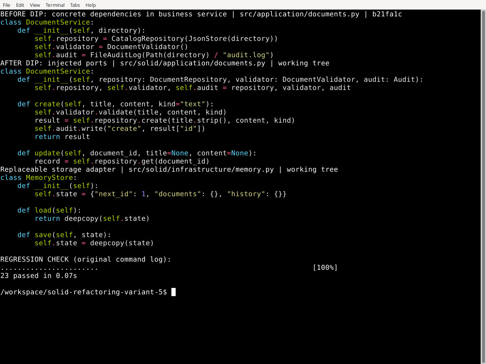

Скриншот 8 — конкретные зависимости до, внедрённые порты и MemoryStore после.

Тест может подставить MemoryStore и MemoryAudit без файловой системы. Направление зависимости идёт от инфраструктуры к контрактам предметной области; domain/application не импортируют инфраструктуру.

## 9. Сохранность исходных тестов и история

Каждый принцип реализован отдельным рабочим коммитом. После SRP, OCP, LSP, ISP и DIP один и тот же набор дал 23 passed. Хэши проверены относительно ce98fb0: сохранены legacy/bad_code.py, conftest.py и tests_before.

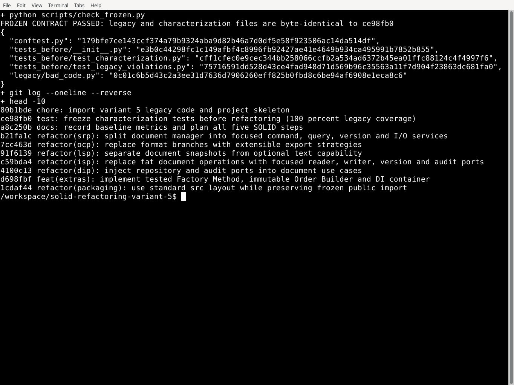

Скриншот 9 — SHA-проверка исходных файлов и действительная история коммитов.

Для mutmut использована стандартная упаковка src/solid: пакет с буквальным именем src конфликтовал со служебным пространством инструмента. Совместимый импорт src.compat оставлен тонким адаптером, поэтому исходный тестовый контракт менять не потребовалось.

## 10. Итоговые тесты и покрытие

В tests_after добавлены проверки новых контрактов, точек расширения, подмены инфраструктуры и дополнительных заданий. Общий результат: 75 passed (23 исходных + 52 новых), покрытие реализации 100% — 357 из 357 исполняемых строк.

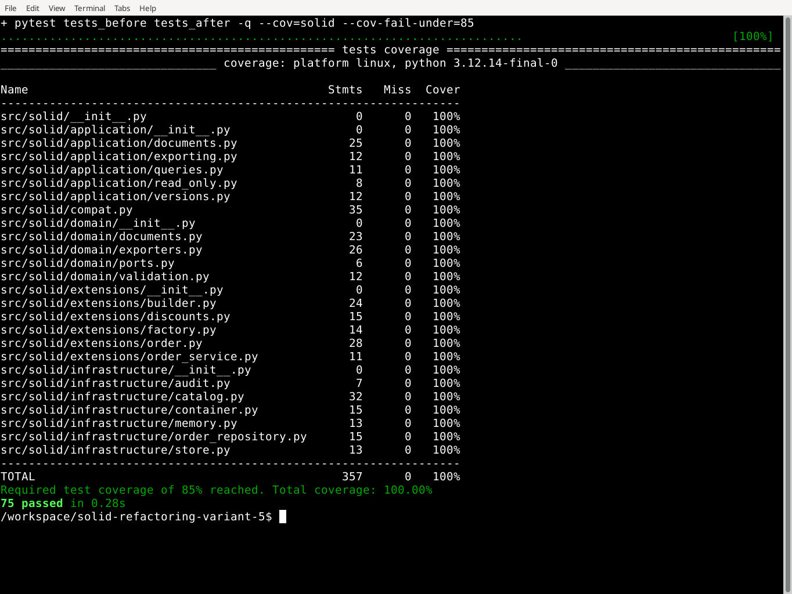

Скриншот 10 — полный pytest-cov после рефакторинга, все тесты проходят.

```text
pytest tests_before tests_after -q --cov=solid --cov-fail-under=85
ruff check .
```

Процент относится к src/solid, включая примеры заказов. Это покрытие строк, а не доказательство полноты всех возможных сценариев. Качество утверждений дополнительно проверено мутациями.

## 11. Финальная структура проекта

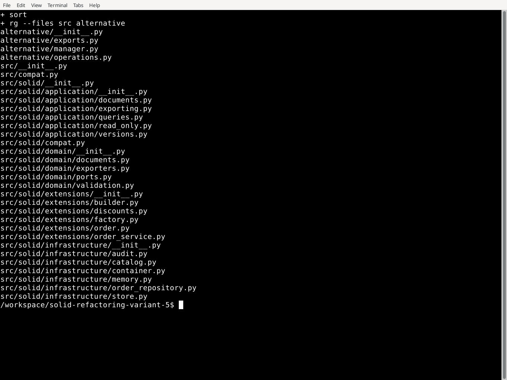

Скриншот 11 — действительные файлы трёх слоёв и независимого альтернативного решения.

domain содержит документы, контракты, валидацию и стратегии экспорта. application содержит сценарии работы. infrastructure содержит JSON, аудит, адаптеры памяти, репозиторий заказов и DI-контейнер. extensions содержит фабрику скидок, модель заказа и Builder.

legacy хранит исходный пример, tests_before — неизменяемый контракт, tests_after — новые проверки. alternative — функциональное решение задания F. scripts содержит метрики, проверку неизменности, мутации и бенчмарк; docs/evidence — исходные подтверждения.

## 12. Метрики после рефакторинга

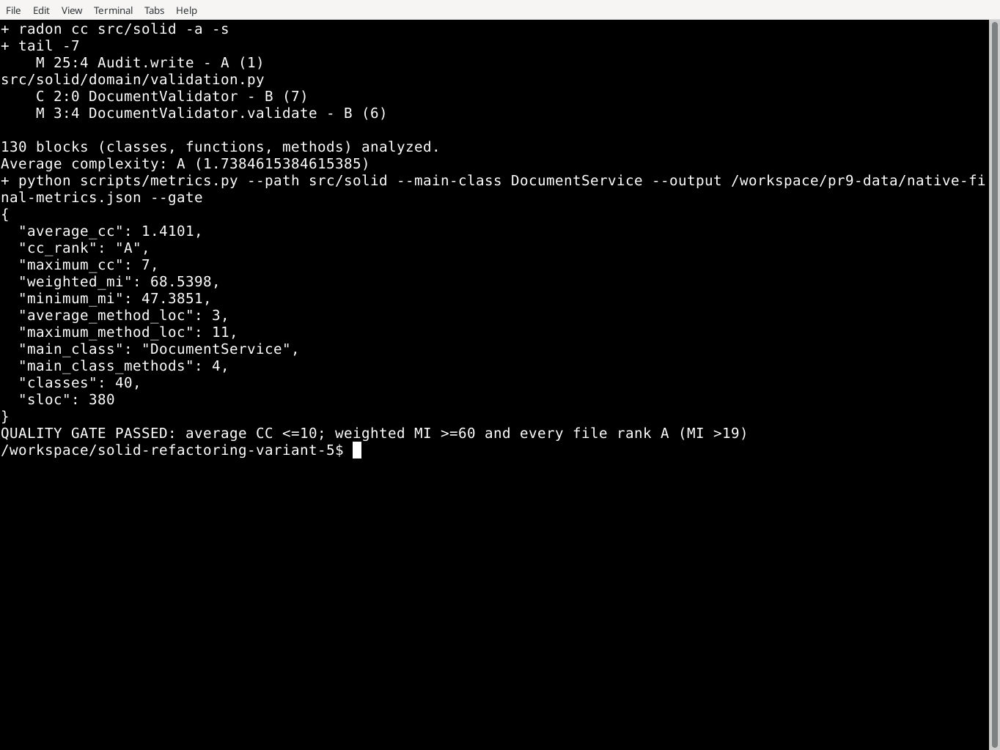

Скриншот 12 — Radon для всей реализации и успешная проверка численных порогов.

Для документного ядра средняя CC уменьшилась на 16,10%, взвешенный MI вырос на 53,77%, максимальный метод уменьшился с 15 до 11 строк. У основного обработчика DocumentService четыре метода против 13 у исходного DocumentManager. У совместимого фасада делегирующие методы сохраняются.

Цена разделения — увеличение ядра со 139 до 248 SLOC и с 6 до 27 классов, включая абстракции. Для всей реализации с A–C: CC 1,4101, weighted MI 68,5398, минимальный MI файла 47,3851, 380 SLOC.

В Radon 6.0.1 MI выше 19 имеет ранг A: исходные 43,81 уже A. Буква B из примерной таблицы методички не воспроизводится. Дополнительно численно проверяется weighted MI ≥60, чтобы улучшение поддерживаемости контролировалось содержательно.

## 13. Запуск программы

```text
python main.py --directory ./demo-data
```

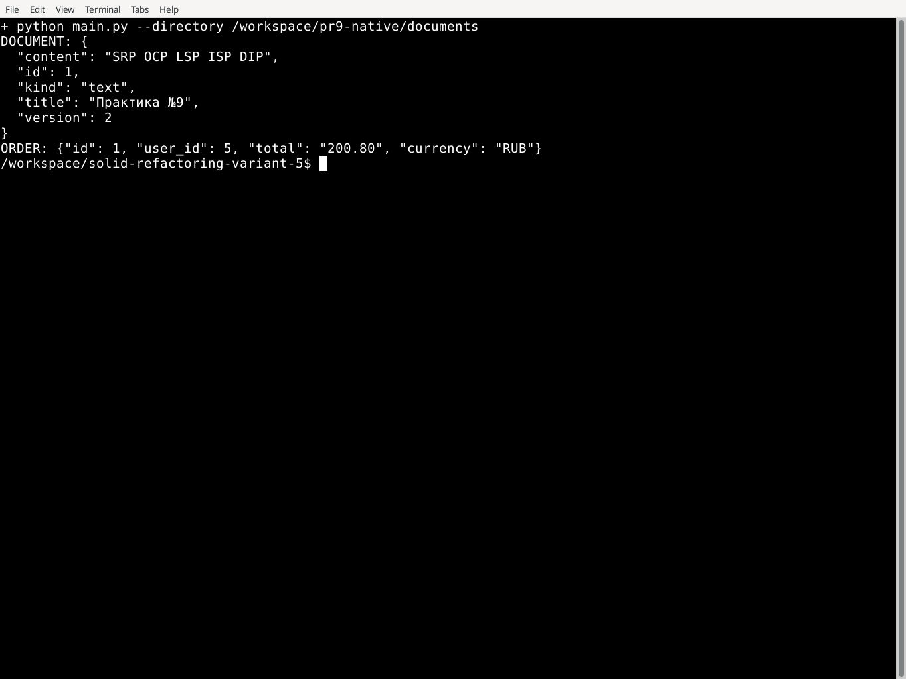

Скриншот 13 — реальный запуск main.py: документ версии 2 и заказ на 200,80 RUB.

Программа создала документ «Практика №9», обновила содержимое и вывела JSON версии 2. Затем DI-контейнер собрал OrderService, который обработал две позиции по 125,50 со студенческой скидкой 20%: 251,00 × 0,80 = 200,80 RUB.

Для запуска достаточно Python 3.12 и установки requirements.txt. Рабочие данные создаются в указанной папке; тесты используют временные каталоги и не меняют эти документы.

```text
python -m venv .venv
. .venv/bin/activate
pip install -r requirements.txt
python main.py --directory ./demo-data
```

## A. Factory Method для скидок

Определены DiscountFactory.create и RegisteredDiscountFactory. Политики: regular 5%, vip 10%, premium 15%, student 20%, неизвестный тип — 0%. Расчёты используют Decimal и округление до двух знаков HALF_UP.

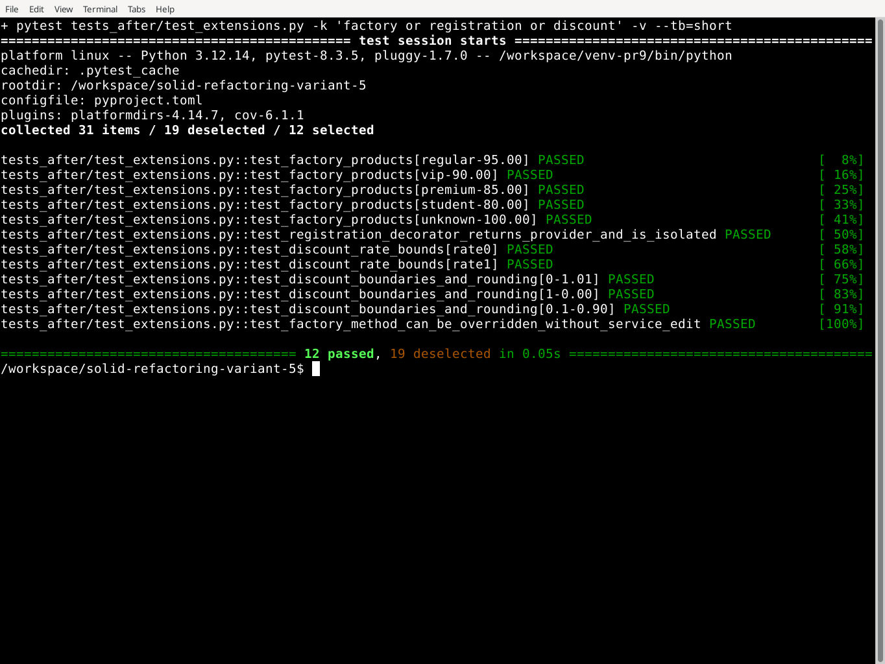

Скриншот 14 — 12 целевых тестов фабрики, политик и расширения через регистрацию.

Новый teacher-провайдер добавляется декоратором register без изменения реализации фабрики и OrderService. Отдельный тест подставляет наследника фабрики с переопределённым create. Таким образом проверены и Factory Method, и реестр расширений.

## B. Builder сложного заказа

OrderBuilder пошагово собирает пользователя, email, позиции, валюту, адрес и примечания. build проверяет обязательные поля, положительные целые ID и количества, неотрицательные цены и поддерживаемую валюту. Готовые Order и OrderLine неизменяемы.

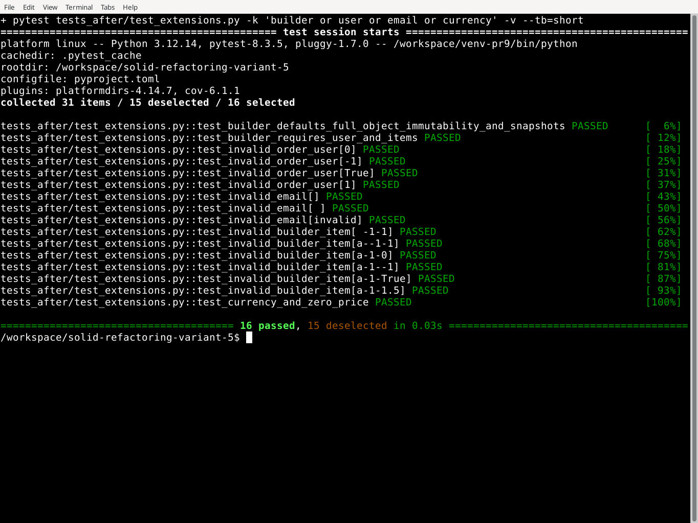

Скриншот 15 — 16 целевых тестов Builder, валидации и неизменяемости.

Builder отвечает за построение валидного объекта, Order — за данные заказа, OrderService — за обработку. Это разделяет причины изменения и поддерживает SRP. Проверка email учебная (наличие @), полной проверки почтовых адресов реализация не обещает.

## C. Простой DI-контейнер

Container предоставляет register, resolve и контекстный override. main.py регистрирует репозиторий, фабрику и провайдер OrderService; сервис разрешает зависимости через контейнер. Репозиторий общий для собранного приложения, экземпляры сервисов создаются провайдерами.

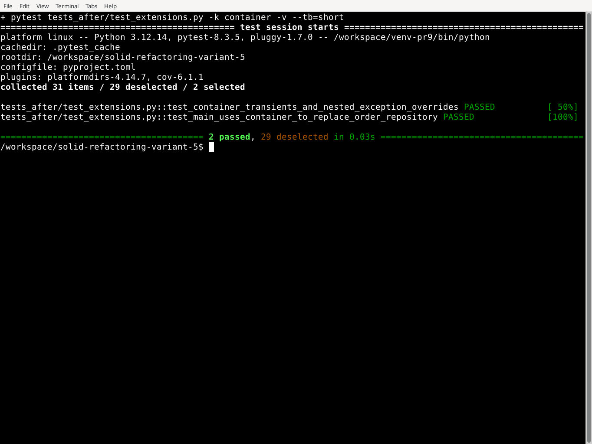

Скриншот 16 — тесты замены зависимости, восстановления override и провайдеров.

В тесте контейнер подменяет репозиторий тестовым, а после выхода из блока восстанавливает прежний провайдер, в том числе при исключении и вложенных подменах. Бизнес-сервис зависит от OrderRepository и DiscountFactory, а конкретный выбор остаётся в точке сборки. Это применение DIP.

## D. Radon и пороги в GitHub Actions

Workflow запускает Ruff, исходный legacy-набор, все финальные тесты, альтернативу и Radon. Пороги: средняя CC ≤10, покрытие ≥85%, weighted MI ≥60, каждый непустой файл имеет реальный ранг MI A (>19). README содержит CI-бейдж.

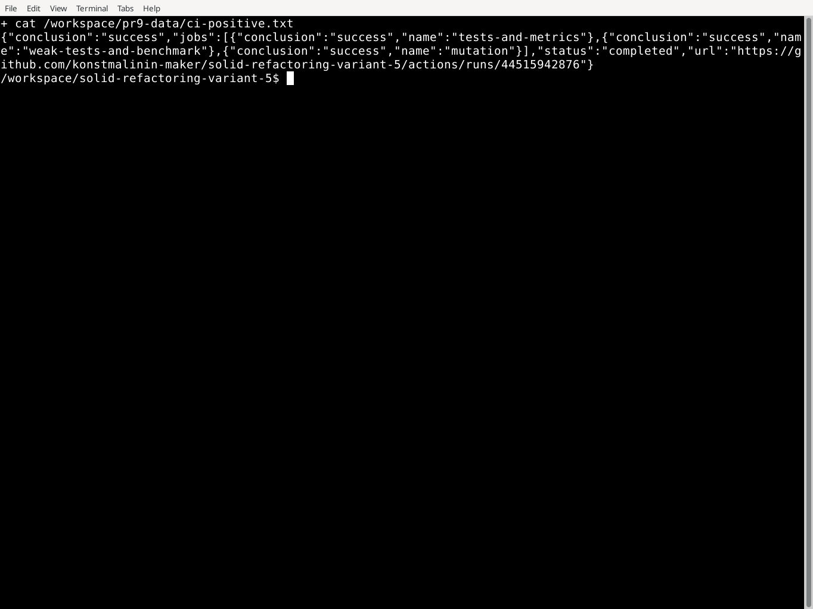

Скриншот 17 — фактический ответ GitHub: три jobs завершились success, run 44515942876.

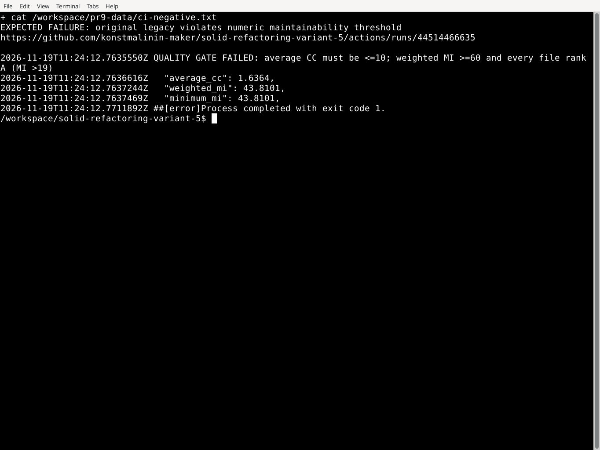

Скриншот 18 — отрицательный контроль: исходный weighted MI 43,8101 отклонён, exit code 1.

Ошибка контрольного workflow ожидаема: она доказывает, что порог действительно блокирует исходное состояние. Основной CI на main после merge прошёл успешно: run 44517856719. Артефакты включают coverage JSON/XML, JUnit, метрики и мутационные результаты.

https://github.com/konstmalinin-maker/solid-refactoring-variant-5/actions/runs/44515942876
https://github.com/konstmalinin-maker/solid-refactoring-variant-5/actions/runs/44514466635

## E. Мутационное тестирование mutmut

Mutmut 3.3.1 изменял весь src/solid без исключений функций. Итог: 496 мутантов, 469 убиты, 27 выжили (5,44% <10%). Нет timeout, skipped и no-tests. Первоначально выживал 31 мутант; новые точные проверки ошибок убили ещё четыре, исходные tests_before не менялись.

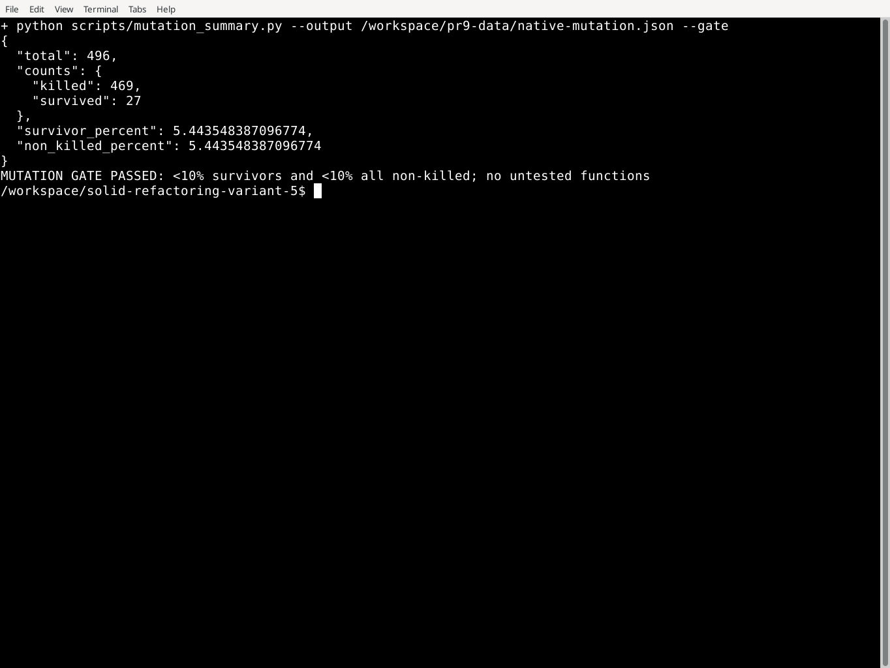

Скриншот 19 — сводка настоящего mutmut и прохождение порога <10%.

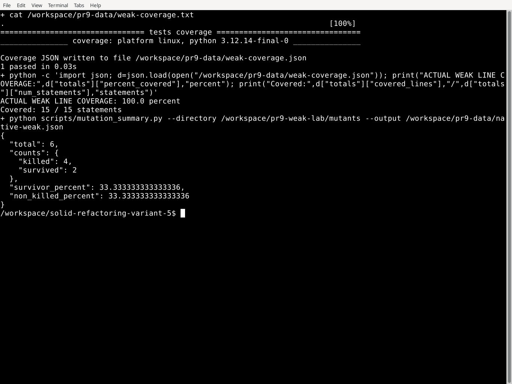

Скриншот 20 — слабые утверждения: покрытие 100% (15/15), но выжили 2 из 6 мутантов (33,33%).

Слабый эксперимент использует байт-в-байт тот же discounts.py, но один smoke-тест проверяет только отсутствие None. Покрытие строк достигает 100%, хотя неверный результат не обнаруживается. Его шесть мутаций относятся к одному модулю, а 496 — ко всей реализации; области анализа не смешиваются.

Примеры выживших мутаций разобраны в docs/mutation-review.md: False→None для ensure_ascii эквивалентно по истинности; изменение форматирования хранения вне публичного контракта может остаться незамеченным. Все 27 безусловно эквивалентными не объявляются.

## F. Альтернативное решение и выбор

Во втором варианте сценарии — функции в alternative/operations.py, а экспорт — dispatch table функций. Он не вызывает основной DocumentService/ExportService; общие модели и I/O-адаптеры включены в область измерения.

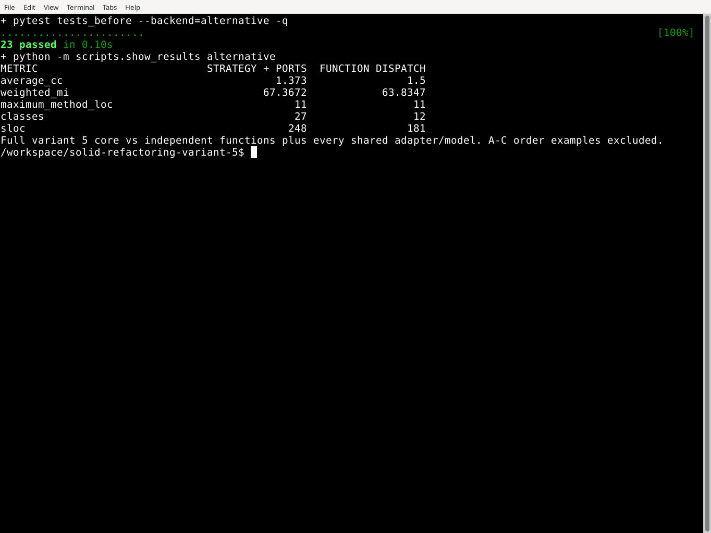

Скриншот 21 — те же 23 теста проходят для альтернативы; фактические метрики двух дизайнов.

| Метрика | SOLID + Strategy | Функции + dispatch |
| --- | --- | --- |
| Средняя CC | 1,3730 | 1,5000 |
| Взвешенный MI | 67,3672 | 63,8347 |
| Макс. длина метода | 11 | 11 |
| Классы / SLOC | 27 / 248 | 12 / 181 |

Для учебной демонстрации пяти принципов выбран основной вариант: порты и стратегии явно показывают контракты и позволяют менять инфраструктуру. Для небольшого приложения с текущим фиксированным набором операций функциональный вариант проще и короче. Дополнительные типы основного решения оправданы ожидаемыми расширениями, а не сами по себе.

Точные списки файлов и оговорки сравнения сохранены в docs/alternative-comparison.json; у основного решения также есть отдельный клиент только для чтения.

## G. Бенчмарк до и после

Использован настоящий timeit: 1000 документов с одинаковым JSON/audit I/O, три повтора в перемешанном порядке; отдельно 1000 заказов, девять повторов. Перед замерами проверяется равенство результатов. Финальный локальный прогон выполнялся после завершения mutmut.

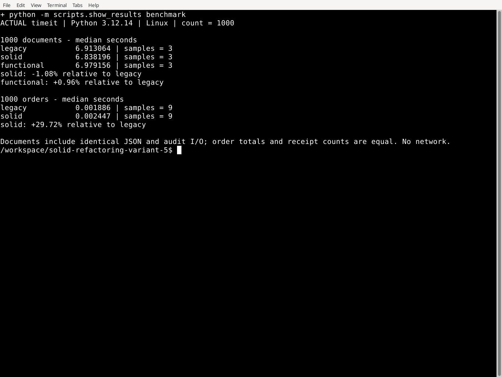

Скриншот 22 — измеренные медианы timeit и относительные изменения.

| Нагрузка | Legacy, с | SOLID, с | Изменение |
| --- | --- | --- | --- |
| 1000 документов | 6,913064 | 6,838196 | −1,08% |
| 1000 заказов | 0,001886 | 0,002447 | +29,72% |

Разница документов мала на фоне файлового I/O; статистически доказанное ускорение не заявляется. Заказный пример медленнее на 29,72%, или около 0,56 мс на 1000 операций: создаётся политика скидки, дополнительно валидируется ставка и вызывается стратегия. Это измеренная стоимость расширяемости, допустимая для учебного примера.

Функциональный вариант: 6,979156 с на 1000 документов (+0,96%). benchmarks/legacy_orders.py — отдельный монолитный эталон для буквального пункта о заказах, а не исходник преподавателя. Все повторы находятся в docs/benchmark.json.

```text
python -m scripts.benchmark
```

## 14. Pull Request и самопроверка

PR №6 объединён в main. Пять Issues по принципам закрыты. Merge-коммит: 28d7d0f10fe3afc446ec0aa7f67a2b5bae7e3d35. Описание PR содержит смысл изменений, метрики и выполненные проверки.

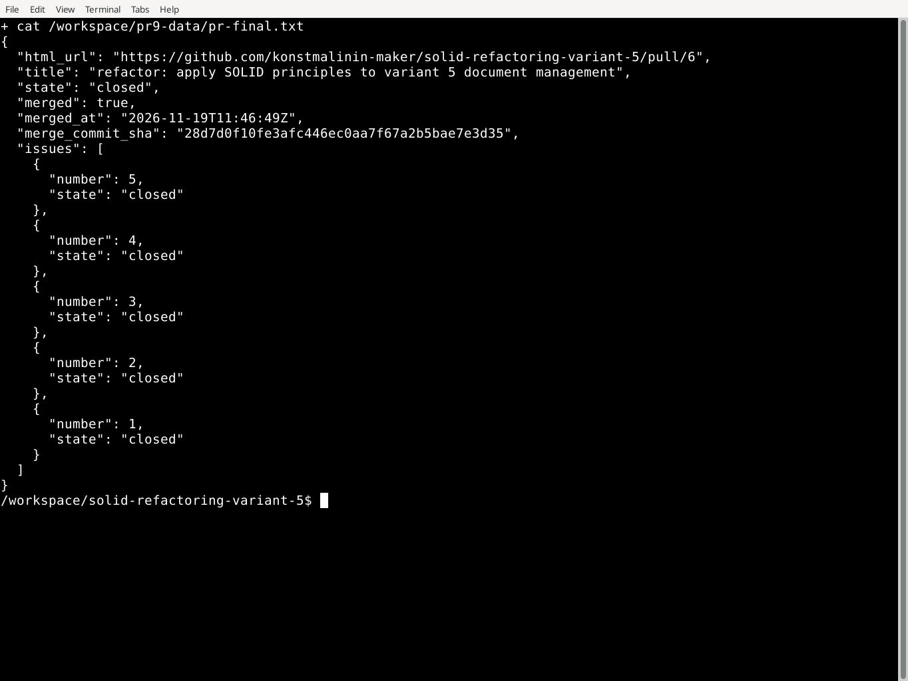

Скриншот 23 — фактическое состояние GitHub: merged=true, Issues №1–5 closed.

https://github.com/konstmalinin-maker/solid-refactoring-variant-5/pull/6

Перед объединением проверены сохранность исходного контракта, направление зависимостей, расширение формата и скидок, ошибки LSP/ISP, подмена контейнера, реальные мутации и бенчмарк. Независимого ревью одногруппника не было; результат самопроверки находится в docs/self-review.md.

## 15. Контрольные вопросы 1–6

1. Что такое характеризующие тесты и зачем они нужны?
Это тесты фактического наблюдаемого поведения существующего кода. Они фиксируют ответы, ошибки и побочные эффекты до изменения структуры. Здесь они удерживают форматы экспорта, историю версий и правила работы с отсутствующим документом.

2. Почему нельзя начинать рефакторинг без покрытия тестами?
Без автоматической проверки трудно отличить перестройку кода от случайного изменения поведения. Сначала покрываются основные сценарии и границы, затем выполняются небольшие шаги с повторным запуском. Сам процент покрытия полезен, но не заменяет содержательные утверждения.

3. Как распознать божественный класс? Три признака.
Он совмещает разные обязанности, имеет много зависимостей и меняется по несвязанным причинам. Например, исходный DocumentManager одновременно знает валидацию, версионирование, экспорт и файлы; изменение любого из этих правил затрагивает один класс.

4. Почему цепочка if/elif нарушает OCP?
Если каждый новый формат требует править уже работающий диспетчер, добавление поведения затрагивает существующий код. Сам if/elif не является безусловной ошибкой; проблема возникает в точке, где ожидается открытый набор расширений.

5. Как Strategy помогает соблюсти OCP?
Алгоритмы скрыты за общим контрактом. Клиент вызывает стратегию, а новый формат добавляется новой реализацией и регистрацией. В этой работе ExportService не изменяется при регистрации Markdown-экспортера.

6. Что значит нарушение LSP? Классический пример.
Подтип нельзя подставить вместо базового типа без нарушения его обещаний. Классический пример — изменяемый Square как Rectangle, когда независимые set_width/set_height перестают быть независимыми. Здесь аналогом был скан, унаследовавший обязательное чтение текста, но отвергавший его.

## 16. Контрольные вопросы 7–12

7. Как ISP связан со связанностью классов?
Узкий интерфейс уменьшает число чужих операций, от которых зависит клиент. ReadOnlyDocumentView получает только чтение и не связан с правилами создания, изменения или удаления документов.

8. Что означает инверсия зависимостей?
Высокоуровневая логика зависит от собственного контракта, а низкоуровневый адаптер реализует этот контракт. В этой работе приложение знает порт репозитория, инфраструктура зависит от порта; выбор JSON или памяти делает внешний код сборки.

9. Как DIP улучшает тестируемость?
Тест передаёт контролируемую реализацию зависимости без изменения бизнес-кода. Можно проверить запись, ошибки и аудит через память или fake-репозиторий, без файловой системы и внешних сервисов.

10. Какие метрики улучшились?
В ядре CC 1,6364→1,3730, weighted MI 43,8101→67,3672, максимальный метод 15→11 строк, методов главного обработчика 13→4. Покрытие осталось 100%. Число классов и SLOC выросло, что отражает цену разделения, а не улучшение всех показателей.

11. Что делать, если характеризующий тест упал?
Остановить следующий шаг, найти первое различие поведения и сравнить с зафиксированным контрактом. Исправить рефакторинг и повторить тесты. Изменять тест допустимо только при отдельно согласованном изменении требований; в этой работе исходные тесты не менялись.

12. Как избежать чрезмерного усложнения?
Выделять абстракции под реальные различия поведения и границы зависимостей, а не ради числа классов. Сравнить с простым решением и измерить стоимость. Альтернативный dispatch-вариант показывает, что для небольшого фиксированного набора форматов достаточно функций.

## 17. Трудности, решения и воспроизведение

1. Сохранение LSP и старой ошибки экспорта. Убрано неверное наследование текстового контракта, но прежний отказ экспорта скана оставлен на границе публичного API. Новые тесты разделяют общий контракт документа и возможность чтения текста.

2. Ограничение mutmut на пакет src. Выполнен переход к стандартному src-layout с пакетом solid. Старый путь src.compat сохранён адаптером, исходные тесты и legacy побайтно не изменены.

3. Покрытие 100% не обнаруживало лишний текст ошибки. Мутации показали слабость regex-проверок. В tests_after добавлены точные сравнения exception.args; число выживших уменьшилось с 31 до 27.

4. Разные области метрик. Основное сравнение не включает добавленные примеры заказов. Для CI отдельно измерена вся реализация. Зафиксированы версии инструмента, формулы и списки файлов, чтобы цифры можно было повторить.

5. Шум бенчмарка и накладные расходы. Финальные измерения выполнены без параллельного mutmut. Замедление заказов не скрывается: причина и абсолютная разница приведены в задании G.

6. Отсутствие второго участника. Проведена самопроверка по checklist, но независимое ревью и одобрение одногруппника не заявляются.

```text
pip install -r requirements.txt
python scripts/check_frozen.py
pytest tests_before --backend=legacy -q --cov=legacy
pytest tests_before tests_after -q --cov=solid --cov-fail-under=85
pytest tests_before --backend=alternative -q
python scripts/metrics.py --path src/solid --output metrics.json --gate
mutmut run --max-children 2
python scripts/mutation_summary.py --output mutation.json --gate
python -m scripts.compare_designs
python -m scripts.benchmark
```

Результат: поведение документного API сохранено, пять принципов показаны отдельными коммитами, A–G реализованы и проверены. Подтверждения доступны в docs/evidence, снимки — docs/pr9-images. Архив содержит отчёт, исходники, оригиналы PNG и Git bundle с историей.
